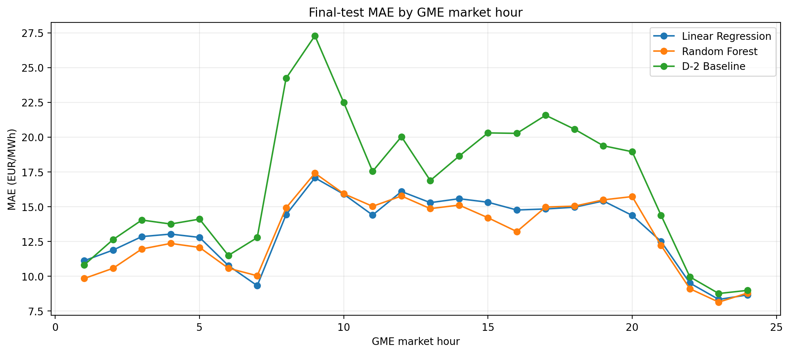
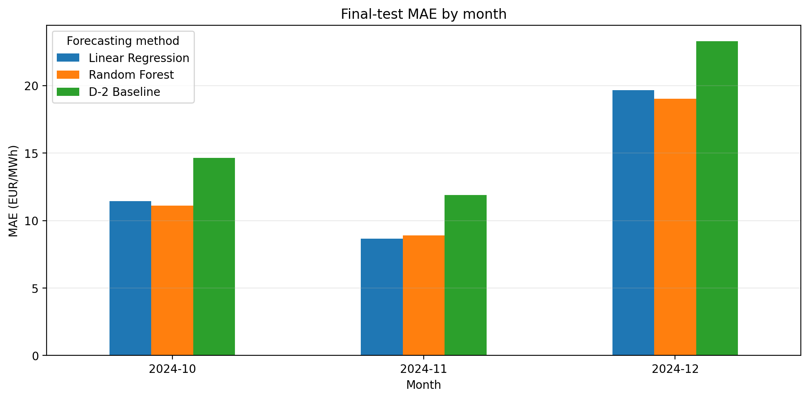
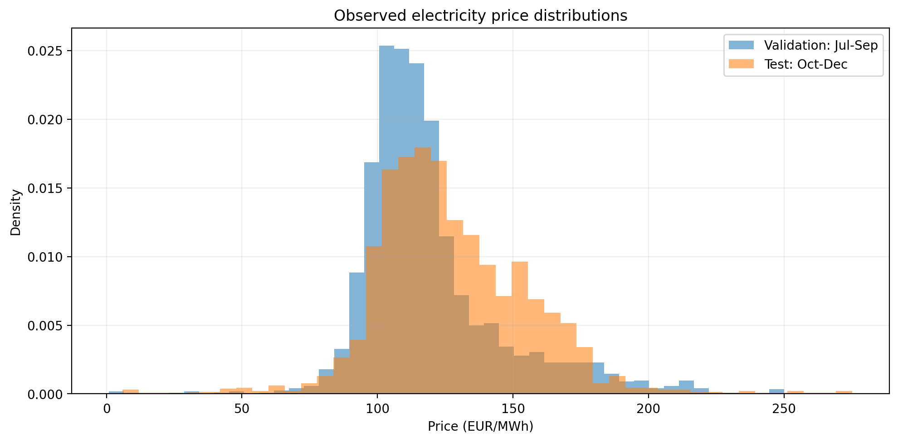

# Figures

This directory contains selected visualizations from the Italian day-ahead electricity price forecasting project.

The figures summarize forecasting performance and differences between validation and test periods using 2024 GME electricity market data.

## 1. Forecasting errors by market hour

**File:** `test_mae_by_hour.png`

Compares the hourly mean absolute error (MAE) of Linear Regression, Random Forest, and the D−2 historical-price baseline on the October–December 2024 test period.

The largest baseline errors occur around GME market hour 9. Both machine learning models substantially reduce the error during these hours.

## 2. Forecasting errors by month

**File:** `test_mae_by_month.png`

Compares forecasting MAE across October, November, and December 2024.

December has the highest forecasting errors for all three methods. Both models outperform the D−2 baseline in each month.

## 3. Validation vs. test price distributions

**File:** `validation_vs_test_price_distribution.png`

Compares observed hourly electricity price distributions between the validation period (July–September 2024) and the test period (October–December 2024).

The average observed price increases from approximately 119.32 EUR/MWh in validation to 127.51 EUR/MWh in test.

The distributions overlap substantially, but their differences provide useful context for interpreting forecasting performance. These descriptive differences do not establish a causal explanation for the change in prediction errors.

## Source notebooks

The figures are based on analyses developed in:

- `notebooks/04_final_model_evaluation.ipynb`
- `notebooks/05_validation_vs_test_diagnostics.ipynb`

The PNG files were exported separately for presentation in the GitHub repository.

## Notes

- Forecasting performance is evaluated on the October–December 2024 test period.
- The distribution comparison uses the original observed prices: 2,208 validation observations and 2,209 test observations, including the additional market hour associated with the autumn daylight-saving-time transition.
- The forecasting test dataset contains 2,208 complete-feature observations.
- All prices and forecasting errors are expressed in EUR/MWh.
